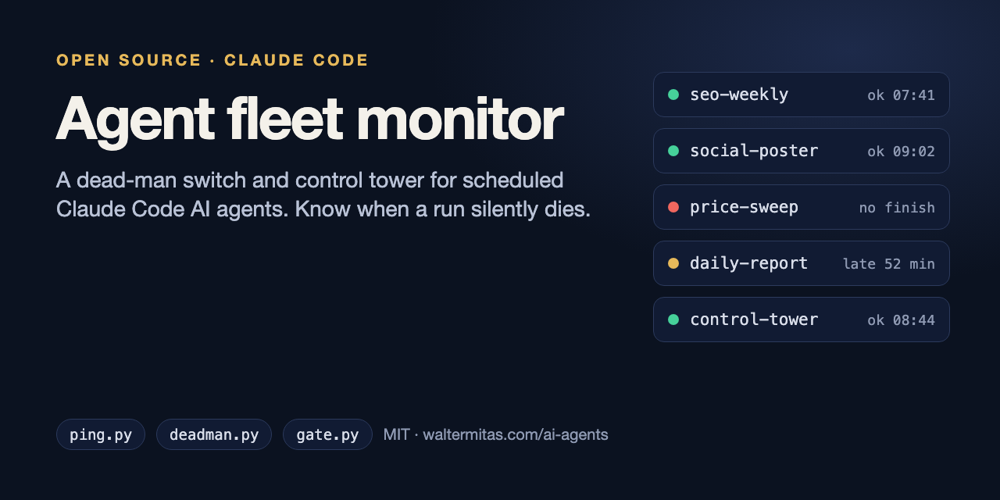
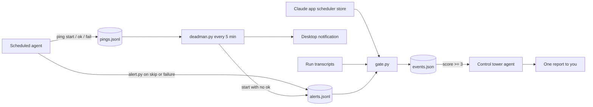

<p align="center"></p>

# Claude Code agent fleet monitor

**A dead-man switch and control tower for scheduled Claude Code AI agents.** Know within minutes when a scheduled run starts and never finishes, when a cron slot never fires, or when an agent quietly reports "nothing to do" because it could not see anything.

   

## The problem

Scheduled AI agents fail silently. A laptop sleeps through a slot. A run hangs on a login page. A browser tool is denied. The agent ends its turn with "nothing new today", which reads exactly like success. With one agent you notice. With thirty you find out a week later.

This repo is the monitoring layer I built for my own fleet of scheduled Claude Code agents. Everything is plain Python with no dependencies, and none of it uses a model until something is actually wrong.

## What is inside

| Piece | What it does | Costs tokens? |
| --- | --- | --- |
| [`scripts/ping.py`](scripts/ping.py) | An agent pings `start` first and `ok` or `fail` last. `--max-late` skips a run that fired too long after its slot. | No |
| [`scripts/deadman.py`](scripts/deadman.py) | Every 5 minutes: flags any run that started and never finished, or that started again after dying. Fires a desktop notification. | No |
| [`scripts/alert.py`](scripts/alert.py) | One line to `alerts.jsonl` when an agent skips or fails. `--once` dedupes for 24 hours. | No |
| [`scripts/gate.py`](scripts/gate.py) | Scans the last N hours: missed cron slots, run transcripts with no final report, permission denials, delivery failures, alerts. Writes `events.json` with a score per event. | No |
| [`skills/control-tower/SKILL.md`](skills/control-tower/SKILL.md) | A scheduled agent that wakes only for events at or above the threshold, tracks open issues, fixes what is safe and reports to you. | Only when something is wrong |

## How it works



Three independent signals catch three different failures:

1. **Dead-man pings** catch a run that started and hung or crashed.
2. **Missed slots** catch a run that never started (asleep, scheduler stuck, task disabled by accident).
3. **Transcript scoring** catches a run that finished but did not deliver (no final report, tool calls denied, "logged out", "nothing was sent").

## Quick start

```bash
git clone https://github.com/waltermitas/claude-agent-fleet-monitor.git
mkdir -p ~/.claude/agent-manager
cp claude-agent-fleet-monitor/scripts/*.py ~/.claude/agent-manager/
```

**1. Ping from every agent.** Put this at the top of each scheduled task's prompt:

```
Your very FIRST action: python3 ~/.claude/agent-manager/ping.py <task-id> start --max-late 90
If it prints LATE (exit 3), stop and do nothing else.
Your very LAST action on EVERY exit path (success, nothing to do, gave up):
python3 ~/.claude/agent-manager/ping.py <task-id> ok     (or: fail "<short reason>")
```

A start with no `ok` or `fail` is what the dead-man check looks for. The rule "on every exit path" matters: an agent that stops early and skips the ping looks like a crash, which is the point.

**2. Run the dead-man check every 5 minutes.** With cron:

```
*/5 * * * * /usr/bin/python3 $HOME/.claude/agent-manager/deadman.py
```

On macOS you can use launchd instead; see [`examples/deadman.plist`](examples/deadman.plist).

**3. Let agents raise their own alerts.** When an agent skips for an infrastructure reason:

```bash
python3 ~/.claude/agent-manager/alert.py my-poster failed "emulator not booted, skipped slot" --once emulator
```

**4. Run the gate** to see what happened since the last run:

```bash
python3 ~/.claude/agent-manager/gate.py
# 757 events, 0 at/above 3 - QUIET
```

**5. Add the control tower** (optional). Create a scheduled task every 3 hours with [`skills/control-tower/SKILL.md`](skills/control-tower/SKILL.md) as the prompt. It runs the gate first, and the model only wakes up for events that scored 3 or more.

### Configuration

| Setting | How |
| --- | --- |
| Per-task dead-man limit | `~/.claude/agent-manager/limits.json`, for example `{"seo-weekly": 180, "poster": 45}`. Default is 90 minutes. |
| Group tasks into areas | `~/.claude/agent-manager/areas.json`, for example `{"seo-": "websites", "poster": "social"}`. |
| Scheduler store location | Set `FLEET_TASKS_FILE` to your `scheduled-tasks.json`. Otherwise the newest match under `~/Library/Application Support/Claude/` is used. |
| Control tower task id | Set `FLEET_SELF_TASK` (default `agent-manager`) so it never reports on itself. |

## Lessons from running it

- **A confident "nothing to report" is the worst failure.** It is indistinguishable from "I could not see anything". Score the absence of a final report as a failure.
- **Stamp the run at the start, not the end.** A throttle stamped at the end of a run lets a crashed run fire again immediately.
- **Two runs seconds apart is normal.** Re-enabling a task fires its missed slot next to "Run now", so the gate refuses to run twice inside 20 minutes (exit code 3).
- **Retimed crons are not misses.** If a task moved 15 minutes later overnight, its run fired at the old time. The gate checks for that before crying wolf.
- **A task created after its latest slot has nothing to miss.** Check `createdAt` first.
- **Match the harness's own wording for denials, and only on error results.** Agents often read notes that quote "blocked by classifier".
- **Wake the model on a score, not a schedule.** A free gate in front of the expensive agent made the control tower cheap enough to run every three hours.

## FAQ

**How do I know if a scheduled Claude Code task failed?**
Add the `ping.py` start and ok lines to its prompt and run `deadman.py` every 5 minutes. A run that never pings `ok` raises an alert and a desktop notification.

**How do I detect a missed cron slot for a Claude Code scheduled task?**
`gate.py` reads the Claude app's scheduled-task store, computes each task's latest due slot, and flags tasks with no run after it.

**Does it need an API key, a database or a server?**
No. It is four Python files and some JSON Lines files on disk. Python 3.9 or newer, standard library only.

**Does it work on Linux or Windows?**
The scripts are portable. The desktop notification uses `osascript` on macOS and is skipped elsewhere. Set `FLEET_TASKS_FILE` if your scheduler store lives somewhere else.

**Can it fix things on its own?**
The control tower skill can edit agent prompts, re-queue approved work and open one-off fix tasks, inside a charter you write. Anything involving money, passwords or deleting data stays with you.

## Related projects

- [watch-hunter-skill](https://github.com/waltermitas/watch-hunter-skill): scheduled AI agents that hunt underpriced watches on ricardo.ch.
- [claude-seo-autopilot](https://github.com/waltermitas/claude-seo-autopilot): a three-runs-a-week SEO and AI search skill.
- [watch-script-skill](https://github.com/waltermitas/watch-script-skill): turns a watch reference into a YouTube script and blog post.

The full fleet, with what each AI agent got wrong, is written up at [waltermitas.com/ai-agents](https://waltermitas.com/ai-agents/).

## Licence

MIT
